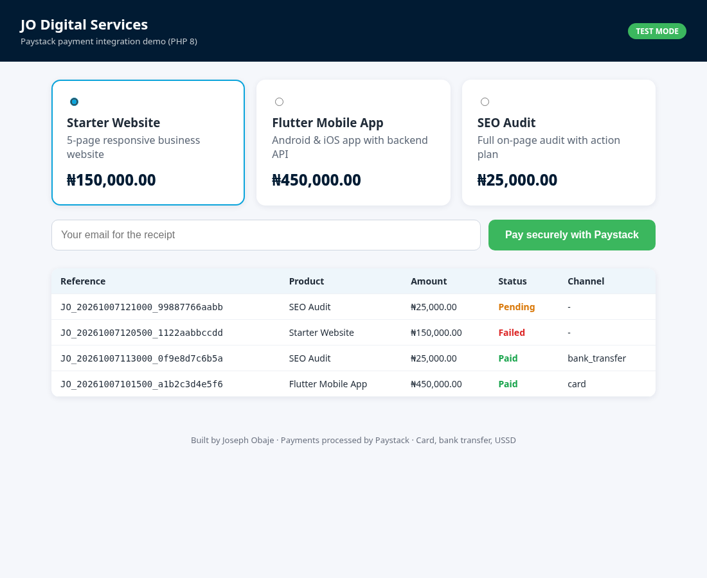

# Paystack Payment Integration (PHP)


A clean, framework-free **Paystack payment integration in PHP 8** that you can drop into any website. It covers the full flow: **initialize** a transaction, redirect to Paystack Checkout, **verify** the payment on the server, and handle **webhooks** with HMAC-SHA512 signature validation. It includes a demo checkout page and fulfils each order exactly once.



## Features

- **`PaystackClient`**: `initialize()`, `verify()`, unique reference generation, test and live mode detection, clear exceptions for API errors
- **`Webhook`**:
  - validates `X-Paystack-Signature` (HMAC-SHA512 of the raw body) with timing-safe `hash_equals`
  - optional check against Paystack's source IP addresses
- **Secure by default**:
  - prices come from the **server-side catalogue**, so the browser can't change the amount
  - the server re-verifies each payment and checks that **amount and currency match** the order before giving value
  - **idempotent fulfilment**, so a callback and a webhook arriving together can't deliver an order twice
  - CSRF token on the checkout form, and output escaping everywhere
  - keys are read from `.env`, never from code
- **Money handled in kobo integers** (`Money::toKobo('2500.55')` returns `250055`), with no float rounding errors
- **Orders stored in SQLite** with PDO (switch to MySQL by changing the DSN)
- **Card, bank transfer, USSD and other channels**: whatever you enable in your Paystack dashboard
- **24 PHPUnit tests** with a fake HTTP transport, so no network or real keys are needed

## Tech stack

PHP 8.1+ (cURL, PDO, JSON), SQLite, Composer (PSR-4 autoloading), PHPUnit 11

## Setup

```bash
git clone https://github.com/Josephobaje/paystack-payment-integration-php.git
cd paystack-payment-integration-php
composer install
cp .env.example .env
```

1. Copy your **test** keys from the [Paystack dashboard](https://dashboard.paystack.com/#/settings/developers) into `.env` (`PAYSTACK_SECRET_KEY=sk_test_...`).
2. Start the demo:

```bash
composer serve        # php -S localhost:8000 -t public
```

3. Open http://localhost:8000, pick a product, enter an email and pay with one of Paystack's [test cards](https://paystack.com/docs/payments/test-payments/).

### Webhooks

In the dashboard, set the webhook URL to `https://your-domain.com/webhook.php`. To test locally, expose port 8000 with a tunnel such as ngrok or cloudflared. In production, set `PAYSTACK_ENFORCE_IP=true`.

## Payment flow

```text
Customer ──POST /pay.php──▶ PaymentService::startCheckout()
                              ├─ create pending order (amount from server catalogue)
                              └─ Paystack /transaction/initialize ──▶ redirect to checkout.paystack.com
Paystack ──redirect──▶ /callback.php?reference=...  ─┐
Paystack ──POST────▶ /webhook.php (signed)          ─┴─▶ PaymentService::confirm()
                                                         ├─ /transaction/verify/{reference}
                                                         ├─ check status, amount and currency
                                                         └─ mark paid once, then deliver
```

## Use it in your own project

```php
use App\Paystack\PaystackClient;
use App\Paystack\Webhook;
use App\Support\Money;

$paystack = new PaystackClient(getenv('PAYSTACK_SECRET_KEY'));
$ref = PaystackClient::generateReference();
$tx = $paystack->initialize('customer@example.com', Money::toKobo('15000'), $ref, 'https://site.com/callback.php');
header('Location: ' . $tx['authorization_url']);

// later, on the callback or in a webhook
$result = $paystack->verify($ref);        // ['status' => 'success', 'amount' => 1500000, ...]

$event = (new Webhook(getenv('PAYSTACK_SECRET_KEY')))
    ->parse(file_get_contents('php://input'), $_SERVER['HTTP_X_PAYSTACK_SIGNATURE'] ?? null);
```

## Running tests

```bash
composer test
```

## Project structure

```text
public/
  index.php          # demo checkout page
  pay.php            # starts a transaction (CSRF-protected)
  callback.php       # customer returns here; verifies the payment
  webhook.php        # signed Paystack events
src/
  Paystack/          # PaystackClient, Webhook, HttpTransport, CurlTransport
  Orders/            # OrderRepository (PDO)
  Support/           # Money (kobo maths), Env (.env loader)
  PaymentService.php # checkout + idempotent confirmation
tests/               # PHPUnit tests with FakeTransport
```

## Author

**Joseph Obaje**, Full Stack Developer (PHP, Python, Flutter) and Cybersecurity Specialist

- GitHub: [@Josephobaje](https://github.com/Josephobaje)
- LinkedIn: [joseph-obaje](https://www.linkedin.com/in/joseph-obaje)
- Email: [josephobaje264@gmail.com](mailto:josephobaje264@gmail.com)

## License

Released under the [MIT License](LICENSE). © 2026 Joseph Obaje
